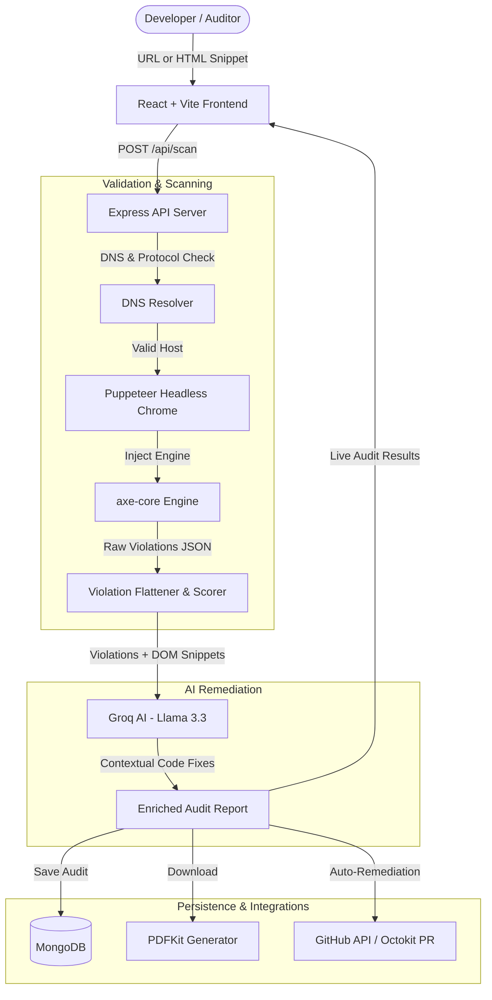

# ♿ EquiDOM — Intelligent Web Accessibility Auditor

<p align="center">
  
  
  
  
  
</p>

> **EquiDOM** automates the entire web accessibility auditing and remediation workflow. It scans live websites or raw HTML snippets with **axe-core**, pinpoints WCAG 2.1/2.2 Level A/AA violations, translates cryptic technical errors into plain English with **Groq AI (Llama 3)**, generates verified code patches, and opens automated **GitHub Pull Requests** directly into your repository.

---

## 🌟 Why EquiDOM?

Standard accessibility scanners (like Lighthouse) only tell you *what* is broken through dense WCAG criteria. **EquiDOM** bridges the developer remediation gap:

1. **Explains the *Why***: Plain-language explanations detailing the real-world impact on users with visual, auditory, cognitive, or motor impairments.
2. **Generates the *Fix***: Copy-paste ready HTML, CSS, and ARIA fixes tailored to your exact DOM nodes.
3. **Automates the *Workflow***: One-click GitHub Pull Request creation that commits fixes straight to a new branch in your repository.
4. **Validates the *Results***: In-browser re-verification scoring and downloadable, audit-ready PDF reports for enterprise compliance.

---

## ✨ Key Features

- **🌐 Dual Auditing Modes**
  - **Live URL Crawling**: Launches a headless Chromium browser instance with full JavaScript hydration, dynamic content rendering, and consent modal handling.
  - **Raw HTML Auditing**: Paste raw markup or templates for instant pre-commit/pre-deployment checks.

- **🛡️ Bulletproof URL & DNS Validation Engine**
  - Pre-flight DNS resolution prevents false audits on non-existent domains before launching the browser.
  - Automatic HTTP response validation catches 404, 403, 410, and soft-404 error pages, preventing misleading reports.

- **📊 Intelligent Weighted Scoring Model**
  - Realistic, standardized scoring based on distinct WCAG rules with a diminishing deduction scale for repetitive DOM instances (e.g., repeating navigation links).

- **🤖 AI Remediation Lab (Powered by Groq Llama 3)**
  - Fast, contextual code fixes, prevention tips, and effort estimates (Low / Medium / High).
  - Built-in deterministic fallbacks for high-availability even during API rate limits.

- **🐙 Automated GitHub Remediation (Auto-PR)**
  - Connect via GitHub OAuth or Personal Access Token.
  - Automatically creates a branch (`fix/accessibility-[timestamp]`), commits remediations, and opens a comprehensive Pull Request.

- **📑 Exportable PDF Reports**
  - Instant PDF generation with compliance status (WCAG 2.0, 2.1, 2.2, Section 508), severity breakdowns, and actionable developer instructions.

- **⚡ Re-Verification & Delta Tracking**
  - Real-time before/after comparison tracking score improvements and resolved issues after code patches are applied.

---

## 🏗️ System Architecture



---

## 🛠️ Technology Stack

| Layer | Technologies |
| :--- | :--- |
| **Frontend** | React 18, Vite, TypeScript, Tailwind CSS, Lucide Icons, Framer Motion, Axios |
| **Backend** | Node.js, Express.js |
| **Scanner Engine** | Puppeteer, `@axe-core/puppeteer`, Node `dns` |
| **AI Inference** | Groq SDK (`llama-3.3-70b-versatile`, `llama-3.1-8b-instant`) |
| **Database & Cache**| MongoDB (Mongoose), `node-cache` |
| **Reporting & Export**| PDFKit |
| **DevOps & Integration** | GitHub REST API / Octokit, Concurrently |

---

## 🚀 Quick Start Guide

### Prerequisites

- **Node.js**: v18.0.0 or higher
- **MongoDB**: Local daemon or [MongoDB Atlas](https://www.mongodb.com/atlas) connection string
- **Groq API Key**: Free API key from [Groq Console](https://console.groq.com)
- **GitHub OAuth App** *(Optional, for Auto-PR feature)*: Registered on [GitHub Developer Settings](https://github.com/settings/developers)

---

### Installation

1. **Clone the repository:**
   ```bash
   git clone https://github.com/rakshitharbola81-afk/EQUIDOM.git
   cd EQUIDOM
   ```

2. **Install all dependencies:**
   ```bash
   npm run install:all
   ```

---

### Environment Setup

#### 1. Backend Configuration (`backend/.env`)

Create a `.env` file inside the `backend/` directory:

```env
PORT=5001
NODE_ENV=development
MONGO_URI=your_mongodb_connection_string
FRONTEND_URL=http://localhost:5173

# AI Remediations
GROQ_API_KEY=your_groq_api_key

# GitHub OAuth & Auto-PR (Optional)
GITHUB_CLIENT_ID=your_github_client_id
GITHUB_CLIENT_SECRET=your_github_client_secret
GITHUB_CALLBACK_URL=http://localhost:5001/api/auth/github/callback
```

> **Note:** Port `5001` is used by default to prevent conflicts with the macOS AirPlay Receiver service on port `5000`.

#### 2. Frontend Configuration (`frontend/.env`)

Create a `.env` file inside the `frontend/` directory:

```env
VITE_API_URL=http://localhost:5001/api
```

---

### Running the Application

Run both frontend and backend concurrently from the root directory:

```bash
npm run dev
```

Or run each service separately:

```bash
# Terminal 1: Backend API (port 5001)
npm run dev:backend

# Terminal 2: Frontend Client (port 5173 or 5174)
npm run dev:frontend
```

Open **`http://localhost:5173`** in your browser.

---

## 🔌 API Reference

### Audits & Scans

| Method | Endpoint | Description | Payload |
| :--- | :--- | :--- | :--- |
| `POST` | `/api/scan` | Run audit on URL or raw HTML | `{ "url": "https://example.com" }` or `{ "html": "..." }` |
| `GET` | `/api/scan/history` | Fetch recent 20 audits | — |
| `GET` | `/api/scan/:id` | Fetch specific audit by ID | — |
| `POST` | `/api/scan/reverify/:id` | Re-scan page to compare score delta | `{ "html": "..." }` *(for snippets)* |
| `GET` | `/api/scan/report/pdf/:id` | Download formatted PDF audit report | — |
| `POST` | `/api/scan/pr` | Create automated GitHub Pull Request | `{ "repoUrl", "filePath", "fileContent" }` |

### GitHub OAuth

| Method | Endpoint | Description |
| :--- | :--- | :--- |
| `GET` | `/api/auth/github` | Redirects to GitHub OAuth consent page |
| `GET` | `/api/auth/github/callback` | OAuth redirect callback handler |
| `GET` | `/api/auth/status` | Verify connected GitHub token status |

---

## 📋 Evaluation Criteria & Compliance

EquiDOM tests against:
- **WCAG 2.0 / 2.1 / 2.2** (Levels A, AA, and critical AAA rules)
- **Section 508** (US Federal accessibility standard)
- Core rules audited:
  - Contrast minimums (`color-contrast`)
  - Image alternative text (`image-alt`, `area-alt`)
  - Form & button labels (`button-name`, `label`, `aria-label`)
  - ARIA markup and landmarks (`region`, `landmark-one-main`)
  - Semantic structure & document metadata (`html-has-lang`, `document-title`)

---

## 🤝 Contributing

Contributions are welcome!
1. Fork the Project
2. Create your Feature Branch (`git checkout -b feature/AmazingFeature`)
3. Commit your Changes (`git commit -m 'Add some AmazingFeature'`)
4. Push to the Branch (`git push origin feature/AmazingFeature`)
5. Open a Pull Request

---

## 📄 License

Distributed under the MIT License. See `LICENSE` for more information.